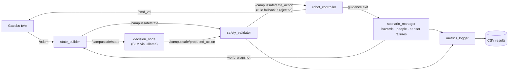

# CampusSafe Twin

**A Digital Twin and Small Language Model–Enabled Autonomous Humanoid Robotic Assistant for Campus Emergency Response and Resilience at Lamar University**


CampusSafe Twin is a research framework for studying **safety-constrained robotic assistance during campus emergencies**. It simulates a campus building — rooms, corridors, exits, occupants, fire, smoke and blocked exits — in a Gazebo digital twin, and lets a robot decide how to help using a **small language model (SLM) running locally through Ollama**. Every action the model proposes passes through an independent **safety validator** before it can reach the robot; anything unsafe or hallucinated is replaced by a deterministic rule-based action.

> **Research question:** Can a safety-validated, SLM-assisted robot improve simulated campus emergency guidance compared with deterministic and no-robot baselines, while keeping latency and invalid actions measurable?

📘 **Full technical documentation** — architecture, requirements, sequence diagrams, scenario details, benchmarks and Q&A: **[docs/SYSTEM_DESIGN.md](docs/SYSTEM_DESIGN.md)**

---

## Table of contents

- [Highlights](#highlights)
- [Implementation status](#implementation-status)
- [How it works](#how-it-works)
- [Project layout](#project-layout)
- [Quick start: offline mode](#1-quick-start-offline-mode-any-os-python-310)
- [Full simulation: ROS 2 + Gazebo](#2-full-simulation-ros-2--gazebo-ubuntu-2404)
- [Emergency scenarios](#emergency-scenarios)
- [Metrics](#metrics)
- [Sample results](#sample-results)
- [Configuration](#configuration)
- [Modelling assumptions](#modelling-assumptions)
- [Extending the project](#extending-the-project)
- [Tests](#tests)
- [Limitations and disclaimer](#limitations-and-disclaimer)
- [Author](#author)

---

## Highlights

- 🏢 **Digital twin** — a Gazebo building world generated from a floor graph, with simulated occupants, hazards and sensor failures.
- 🧠 **Local SLM decision layer** — models such as `llama3.2:3b`, `qwen3:4b`, `phi4-mini` or `gemma3:4b` served by Ollama; no cloud inference needed.
- 🛡️ **Safety validator** — the SLM never drives motors. It picks from five fixed actions, and the validator rejects nonexistent rooms, unsafe exits and malformed output, substituting a rule-based action.
- ⚖️ **Four interchangeable policies** — `slm`, `rule` (baseline), `mock` (deliberately faulty, to test the validator) and `none` (no robot).
- 📊 **Automatic metrics** — evacuation rate and time, hazard exposure, invalid-action rate, decision latency and replanning time, written to CSV.
- 💻 **Two run modes** — a pure-Python offline runner for fast batch experiments on any OS, and a full ROS 2 + Gazebo simulation.

## Implementation status

| Component | Status |
| --- | --- |
| Gazebo campus building world, occupants, fire/smoke/blocked exits | ✅ Implemented |
| Named emergency scenarios | ✅ Implemented |
| Structured situation reports for policies | ✅ Implemented |
| Ollama SLM policy + rule, mock and no-robot baselines | ✅ Implemented |
| Safety validation with rule-based fallback | ✅ Implemented |
| ROS 2 motion control of a simulated robot | ✅ Implemented |
| CSV outcome and decision logging | ✅ Implemented |
| Physical humanoid robot | 🔜 Future work |
| Live campus sensor synchronization | 🔜 Future work |

> The current robot is a simplified simulated mobile base, and the floor plan is a modelled building — not yet a verified Lamar floor plan or a live, sensor-synchronized twin.

## How it works



The system runs six ROS 2 nodes. On every decision cycle:

1. **`state_builder`** combines robot odometry and the world snapshot into a structured situation report.
2. **`decision_node`** asks the configured policy for one action. Supported actions: `navigate_to`, `guide_to_exit`, `announce`, `report_hazard`, `wait`.
3. **`safety_validator`** checks the action type, that referenced nodes exist in the building graph, known hazard locations, that guidance exits are safe and reachable, hazard-report references, and that announcements are non-empty and ≤ 240 characters. Rejected proposals are replaced by the rule-based action.
4. **`robot_controller`** turns the validated action into `/cmd_vel` motion commands.
5. **`metrics_logger`** records every proposal, whether it was accepted, why, and the final outcomes.

The **rejection rate is itself a thesis metric** — it measures how often the model hallucinates or proposes something unsafe.

## Project layout

```
campussafe-twin/
├── run_offline.py                  # fast experiments, no ROS/Gazebo needed
├── requirements.txt
├── docs/SYSTEM_DESIGN.md           # full system design and architecture
├── results/gazebo/                 # saved per-run decision and summary CSVs
└── ros2_ws/src/campussafe_twin/    # ROS 2 (ament_python) package
    ├── campussafe_twin/core/       # ROS-independent logic, shared by both modes
    │   ├── building.py             # floor graph + wall geometry  ← put real Lamar floor plans here
    │   ├── scenarios.py            # fire_north, blocked_exit, sensor_loss, multi_hazard
    │   ├── world.py                # simulated occupants and hazards
    │   ├── knowledge.py            # what the robot knows (sensors online/offline)
    │   ├── state.py                # situation report given to every policy
    │   ├── policies.py             # SLM, rule baseline, mock SLM, no-robot  ← SLM prompt lives here
    │   ├── slm_client.py           # Ollama client (stdlib only)
    │   ├── validator.py            # safety checks
    │   ├── actions.py              # the fixed action set
    │   ├── episode.py              # offline decision loop
    │   └── metrics.py
    ├── campussafe_twin/nodes/      # the six ROS 2 nodes
    ├── worlds/campus_building.sdf  # GENERATED by tools/generate_world.py
    ├── launch/campussafe.launch.py
    ├── config/params.yaml
    ├── tools/generate_world.py
    └── test/test_core.py
```

## 1. Quick start: offline mode (any OS, Python 3.10+)

No ROS, Gazebo or GPU needed — offline mode uses only the Python standard library. Use it to develop prompts and run batch experiments.

```bash
git clone https://github.com/ARNAV-GHATE/campussafe-twin.git
cd campussafe-twin

python run_offline.py                                            # rule baseline, all scenarios, 3 trials
python run_offline.py --policy rule mock none --trials 5         # compare policies
python run_offline.py --scenario blocked_exit --policy rule -v   # print every decision
```

| Flag | Default | Description |
| --- | --- | --- |
| `--scenario` | `all` | One or more of `fire_north`, `blocked_exit`, `sensor_loss`, `multi_hazard` |
| `--policy` | `rule` | One or more of `rule`, `slm`, `mock`, `none` |
| `--model` | `llama3.2:3b` | Ollama model tag for `--policy slm` |
| `--host` | `http://localhost:11434` | Ollama server address |
| `--trials` | `3` | Runs per scenario/policy, each with a different seed |
| `--out` | `results/offline_results.csv` | CSV output path (one row per run) |
| `-v` | off | Print every decision |

### With a real small language model

1. Install Ollama: https://ollama.com
2. Pull a model and run:

```bash
ollama pull llama3.2:3b
python run_offline.py --policy slm rule none --model llama3.2:3b --trials 5 --out results/llama3b.csv
```

Other models worth benchmarking: `qwen3:4b`, `phi4-mini`, `gemma3:4b` (check `ollama list` or the Ollama library for current tags). If Ollama isn't reachable, the runner exits with a hint — use `--policy mock` to exercise the validator without a model.

## 2. Full simulation: ROS 2 + Gazebo (Ubuntu 24.04)

Tested target: **ROS 2 Jazzy + Gazebo Harmonic** (the default pairing). ROS 2 Lyrical + Gazebo Jetty should also work.

```bash
# Install ROS 2 Jazzy: https://docs.ros.org/en/jazzy/Installation/Ubuntu-Install-Debs.html
sudo apt install ros-jazzy-ros-gz python3-colcon-common-extensions

cd campussafe-twin/ros2_ws
source /opt/ros/jazzy/setup.bash
colcon build --symlink-install
source install/setup.bash

ollama serve &                       # only needed for policy:=slm
ros2 launch campussafe_twin campussafe.launch.py                                   # fire_north, SLM
ros2 launch campussafe_twin campussafe.launch.py scenario:=blocked_exit policy:=rule
ros2 launch campussafe_twin campussafe.launch.py scenario:=multi_hazard policy:=slm model:=qwen3:4b
```

Gazebo opens with the building, green exit pads and the robot. Red cylinders rise where hazards appear. When the scenario ends, `metrics_logger` prints a summary and writes CSVs to `~/campussafe_results/`.

Useful topics while it runs:

```bash
ros2 topic echo /campussafe/safe_action     # what the robot decided, and whether the SLM was overruled
ros2 topic echo /campussafe/state --once    # the exact situation report the SLM sees
ros2 topic echo /campussafe/announce        # public announcements
```

## Emergency scenarios

| Scenario | Events |
| --- | --- |
| `fire_north` | Fire in N2 at 0 s; smoke at C15 at 45 s and C10 at 90 s |
| `blocked_exit` | EXIT_WEST blocked at 0 s; smoke at C38 at 60 s |
| `sensor_loss` | Fire at C30 at 0 s; building sensor failure at 20 s; smoke at C25 at 50 s |
| `multi_hazard` | Fire at N3; EXIT_EAST blocked at 30 s; sensor loss at 60 s; smoke at C10 at 90 s |

Each scenario starts with **32 simulated occupants**: N1 (4), N2 (6), N3 (5), N4 (3), S1 (4), LOBBY (6), S3 (4).

## Metrics

Recorded per run:

| Column | Meaning |
| --- | --- |
| `pct_evacuated`, `total_evacuation_time_s`, `mean_evacuation_time_s` | Effectiveness and coverage |
| `people_exposed`, `exposures` | People who got close to fire or smoke |
| `invalid_rate_pct` | Share of SLM actions the validator rejected (hallucination / safety) |
| `mean_latency_ms`, `p95_latency_ms` | Decision latency (use for edge-hardware comparisons) |
| `guidance_replan_time_s` | Time from "guided exit became unsafe" to switching exits (resilience) |

## Sample results

Two individual Gazebo runs of `blocked_exit` from October 28, 2026 (from `results/gazebo/`). These are single examples, **not** statistically aggregated results.

| Metric | Rule run `120531` | SLM run `131619` (`llama3.2:3b`) |
| --- | ---: | ---: |
| Evacuated | 32 / 32 (100%) | 32 / 32 (100%) |
| Total evacuation time | 123.0 s | 130.4 s |
| Mean evacuation time | 60.0 s | 83.2 s |
| People exposed | 7 | 8 |
| Decisions / invalid | 24 / 0 | 26 / 0 |
| Mean / p95 latency | ~0 ms / 0.1 ms | 1594.5 ms / 2677.5 ms |

Both runs evacuated everyone; this rule run was faster with fewer exposures. Other saved SLM runs had very different invalid-action rates (some rejected every proposal and fell back to rules), so matched-seed experiments across many trials are needed before drawing conclusions. See [Appendix A of the system design](docs/SYSTEM_DESIGN.md#7-appendix) for discussion.

## Configuration

ROS 2 defaults live in [`config/params.yaml`](ros2_ws/src/campussafe_twin/config/params.yaml) and can be overridden as launch arguments (e.g. `scenario:=`, `policy:=`, `model:=`).

| Parameter | Default |
| --- | --- |
| `scenario` | `fire_north` |
| `policy` | `slm` |
| `model` | `llama3.2:3b` |
| `ollama_host` | `http://localhost:11434` |
| `rate_hz` | `10.0` |
| `decision_period` | `5.0` s |
| `seed` | `0` |
| `spawn_x`, `spawn_y`, `spawn_yaw` | `20.0`, `0.0`, `0.0` |
| `output_dir` | `~/campussafe_results` if empty |

## Modelling assumptions

State these alongside any reported results:

- Occupants react to the alarm after 15–90 s, walk at 1.2 m/s, head for the nearest exit, and only learn about a hazard within 3 m of it (then pause 10 s and re-plan).
- People within 8 m of the robot follow its guidance and learn the hazards it knows; announcements reach unaware people within 12 m.
- The robot moves at 1.0 m/s, senses hazards within 6 m and people within 8 m. Building sensors give full information until a sensor-loss event.
- The twin is simulation-based (static floor plan + scripted events), not yet synced to live campus data.

## Extending the project

| Next step | Where |
| --- | --- |
| Real Lamar floor plan | `core/building.py` (`lamar_cs_floor`, `wall_segments`), then `python3 tools/generate_world.py` |
| New emergencies | `core/scenarios.py` |
| Better prompts / few-shot examples | `SYSTEM_PROMPT` in `core/policies.py` |
| Humanoid model | Replace `campus_robot` in `tools/generate_world.py` with a humanoid description (e.g. Unitree H1/G1); keep the `/cmd_vel` + `/odom` interface |
| Nav2 navigation | Replace `_drive()` in `nodes/robot_controller.py` with a Nav2 `NavigateThroughPoses` client |
| Speech | Feed `/campussafe/announce` to a TTS engine (e.g. Piper) |
| Edge benchmark | Run `run_offline.py --policy slm` on a Jetson Orin NX vs. an RK3588 board and compare latency |

Recommended research next steps: paired policy benchmarks with the same scenarios and seeds, aggregation across repeated trials, and separating fallback-mediated success from accepted SLM decisions.

## Tests

```bash
pip install -r requirements.txt     # just pytest
python3 -m pytest ros2_ws/src/campussafe_twin/test
```

## Limitations and disclaimer

CampusSafe Twin is a **simulation-based research prototype**. The validator checks *known* hazards and modelled routes, not unknown real-world risks, and a 0% invalid-action rate does not prove safety. Results from this simulator do **not** constitute real-world evacuation safety certification and must not be used to guide actual emergency response.

## Author

**Arnav Ghate** — Lamar University

For the complete design rationale, glossary, requirements and Q&A, see **[docs/SYSTEM_DESIGN.md](docs/SYSTEM_DESIGN.md)**.
