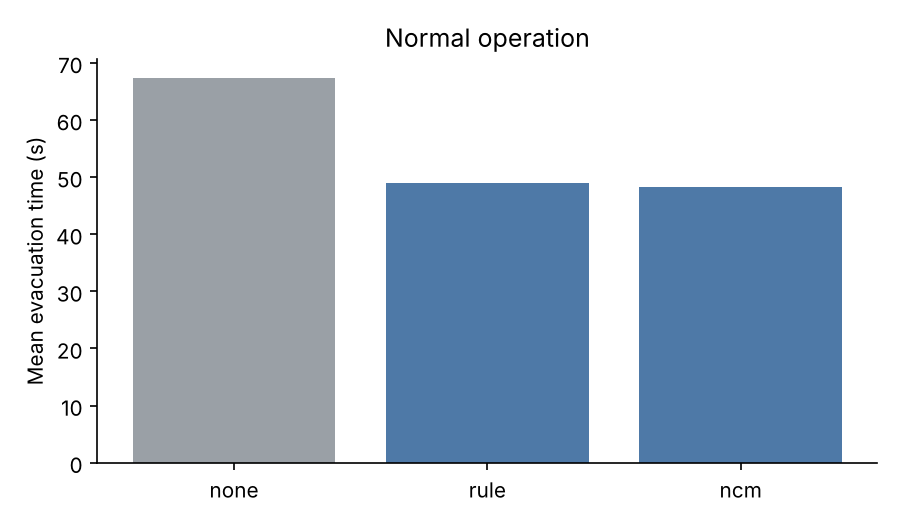
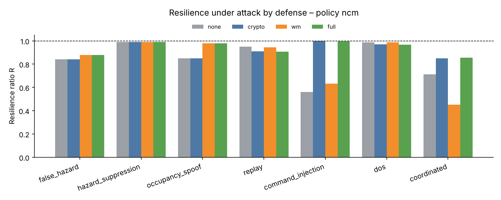
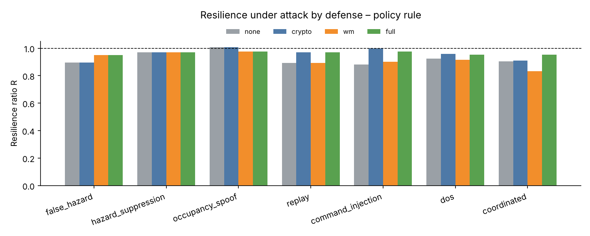

# Results: World Models + NCM under cyberattack

Offline digital twin, 4 held-out scenarios (`fire_north`, `blocked_exit`, `sensor_loss`, `multi_hazard`) × 5 seeds, 32 occupants each. **1,300 episodes** for the main grid, generated by `python run_experiments.py` (November 11, 2026, ~3 min on 2 CPU cores). Raw data: [`results/raw.csv`](results/raw.csv), per-condition means: [`results/summary.csv`](results/summary.csv), auto-generated tables: [`results/report.md`](results/report.md).

Policies: `none` (no robot), `rule` (hand-written baseline), `ncm` (world model + Next-Concept Modeling planner, the proposed method). The learned models never saw these four scenarios during training.

Resilience ratio **R** = (evacuated % under attack / normal) × min(1, mean evacuation time normal / under attack). R = 1 means the attack had no effect.

## 1. Normal operation

| Policy | Evacuated | Mean evacuation time | People exposed to fire/smoke | Invalid actions | Decision latency |
|---|---|---|---|---|---|
| none | 97.5 % | 67.3 s | 5.9 | – | – |
| rule | 98.0 % | 49.0 s | 4.8 | 0.0 % | <0.1 ms |
| **ncm** | **98.3 %** | **48.2 s** | **3.5** | 1.1 % | 6.7 ms |

| Mean evacuation time (s) | fire_north | blocked_exit | sensor_loss | multi_hazard |
|---|---|---|---|---|
| none | 56.4 | 81.8 | 65.3 | 65.7 |
| rule | **45.7** | **55.2** | 43.0 | 52.1 |
| ncm | 51.9 | 56.2 | **35.9** | **48.9** |



**Paired comparison, ncm − rule (20 matched scenario/seed pairs, 95 % CI):** evacuation time −0.8 ± 2.8 s, people exposed −1.2 ± 1.2, evacuated +0.3 ± 0.6 pp. The learned planner is **on par with the hand-written baseline** (differences not statistically significant), with a trend toward fewer exposures; it never evacuated fewer people. Both cut mean evacuation time by ~27 % versus no robot. It is fastest where the world model's belief matters most (`sensor_loss`, building sensors fail at 20 s: 35.9 s vs 43.0 s) and slower on `fire_north`.

**Reliability.** 1.1 % of NCM's first decisions were rejected by the safety validator (all replaced by the rule fallback); the rule baseline is valid by construction. NCM plans in 4 parallel passes, ~7 ms per decision on CPU, vs ~1–3 s for the 3B-parameter SLM in earlier runs.

### Ablation: planning in imagination (`wm_ncm`)

Selecting among 8 sampled plans by rolling them out in the world model's imagination **hurt** safety, even with a conservative 5 % margin:

| | fire_north | blocked_exit | sensor_loss | multi_hazard |
|---|---|---|---|---|
| wm_ncm evacuated | 85.6 % | 91.9 % | 93.1 % | 100 % |
| ncm evacuated | 100 % | 100 % | 93.1 % | 100 % |

The selector overrode the greedy plan on ~95 % of decisions, choosing plans whose imagined outcomes looked good only because of model error (guidance switching exits every few seconds). This is the known **model-exploitation** problem of model-based planning: optimizing against a learned model finds its mistakes. The world model is therefore used for *belief and forecasting* (inputs to the planner) and for *attack detection*, not as an optimization target. Data: [`results/ablation_wm_ncm_normal.csv`](results/ablation_wm_ncm_normal.csv).

## 2. Attack impact (no defense)

| Attack | rule R | ncm R | rule: evac / time / exposed | ncm: evac / time / exposed |
|---|---|---|---|---|
| false_hazard | 0.89 | 0.84 | 87.7 % / 43.5 s / 5.2 | 92.7 % / 54.0 s / 5.5 |
| hazard_suppression | 0.97 | 0.99 | 96.7 % / 49.8 s / 5.1 | 97.2 % / 47.2 s / 3.9 |
| occupancy_spoof | 1.01 | 0.85 | 98.6 % / 46.1 s / 3.6 | 98.9 % / 57.2 s / 4.8 |
| replay | 0.89 | 0.95 | 97.8 % / 54.9 s / 4.7 | 98.3 % / 50.8 s / 3.5 |
| command_injection | 0.88 | **0.56** | 97.8 % / 55.4 s / 4.8 | 86.7 % / 75.8 s / 3.5 |
| dos | 0.92 | 0.99 | 98.0 % / 53.0 s / 4.7 | 98.3 % / 48.8 s / 3.6 |
| coordinated | 0.90 | **0.71** | 88.6 % / 47.9 s / 4.8 | 72.2 % / 49.7 s / 6.6 |

- **The most damaging attacks are a fake fire at the busiest exit** (people trapped: only 88 % evacuated with the rule policy) **and forged commands**.
- **The learned planner is more fragile to command injection** (R 0.56 vs 0.88): a likely explanation (not yet verified) is that its plans are conditioned on the current guidance state, so a forged *guide to worst exit* shifts what it plans next, while the rules re-derive the correct exit from scratch at every decision.
- The learned planner is **more robust to stale data** (replay R 0.95 vs 0.89, DoS 0.99 vs 0.92), consistent with its world-model belief compensating for missing updates.

## 3. Defenses

Detection rate / mean detection delay / R. Attacks start at t = 10 s.

**Policy `ncm`**

| Attack | none | crypto | wm | full |
|---|---|---|---|---|
| false_hazard | R 0.84 | 0 % / – / 0.84 | **100 % / 0 s / 0.88** | 100 % / 0 s / 0.88 |
| hazard_suppression | R 0.99 | 0 % / – / 0.99 | 5 % / 221 s / 0.99 | 5 % / 221 s / 0.99 |
| occupancy_spoof | R 0.85 | 0 % / – / 0.85 | **100 % / 5 s / 0.98** | 100 % / 5 s / 0.98 |
| replay | R 0.95 | **100 % / 0 s / 0.91** | 25 % / 80 s / 0.94 | 100 % / 0 s / 0.91 |
| command_injection | R 0.56 | **100 % / 0 s / 1.00** | 0 % / – / 0.63 | 100 % / 0 s / 1.00 |
| dos | R 0.99 | **100 % / 4 s / 0.97** | 0 % / – / 0.99 | 100 % / 4 s / 0.97 |
| coordinated | R 0.71 | 100 % / 0 s / 0.85 | 100 % / 0 s / 0.45 | **100 % / 0 s / 0.86** |
| *false alarms, no attack* | 0 % | 0 % | 25 % | 25 % |

**Policy `rule`**

| Attack | none | crypto | wm | full |
|---|---|---|---|---|
| false_hazard | R 0.89 | 0 % / – / 0.89 | **100 % / 0 s / 0.95** | 100 % / 0 s / 0.95 |
| hazard_suppression | R 0.97 | 0 % / – / 0.97 | 55 % / 55 s / 0.97 | 55 % / 55 s / 0.97 |
| occupancy_spoof | R 1.01 | 0 % / – / 1.01 | 100 % / 5 s / 0.98 | 100 % / 5 s / 0.98 |
| replay | R 0.89 | **100 % / 0 s / 0.97** | 0 % / – / 0.89 | 100 % / 0 s / 0.97 |
| command_injection | R 0.88 | **100 % / 0 s / 1.00** | 10 % / 168 s / 0.90 | 100 % / 0 s / 0.97 |
| dos | R 0.92 | **100 % / 4 s / 0.96** | 0 % / – / 0.92 | 100 % / 4 s / 0.95 |
| coordinated | R 0.90 | 100 % / 0 s / 0.91 | 100 % / 0 s / 0.83 | **100 % / 0 s / 0.95** |
| *false alarms, no attack* | 0 % | 0 % | 25 % | 25 % |




### Findings

1. **The two defense layers are complementary; only the combination covers both attack families.** Cryptography detects 100 % of network attacks (replay, DoS, forged commands) instantly and cannot see compromised-sensor attacks at all (0 %). The world-model monitor detects 100 % of fake hazards and spoofed counts (0–5 s) and is blind to forged commands. `full` detects six of the seven attack types 100 % of the time; only stealthy hazard suppression is caught partially (finding 5).
2. **The world model catches lies a valid signature hides.** A fake fire at an exit gets probability < 10⁻⁴ under the learned physics (fires never start at exit doors) and is quarantined at the instant of injection; the robot then checks it with its own sensors, clears it and tells nearby people. Spoofed occupancy is flagged within one 5-s tick, restoring `ncm` from R 0.85 to 0.98.
3. **A partial defense can be worse than none.** Under the coordinated attack, `wm` alone gives R 0.45 for `ncm` (vs 0.71 undefended): it correctly distrusts the compromised feed, switching to onboard sensing, but forged commands still get through, so the robot is both half-blind and hijacked. With `full`, R = 0.86.
4. **Fail-safe has a cost.** When crypto detects replay or DoS, the robot drops the building feed and relies on its own sensors. For `ncm` that is slightly worse than acting on stale data (replay R 0.91 vs 0.95), because stale-but-plausible data was still informative in these scenarios.
5. **Hazard suppression is a low-impact, hard-to-detect attack here** (R ≥ 0.97 undefended). It is only caught when the robot happens to see a hidden hazard itself (55 % for rules, 5 % for `ncm`; presumably because the two policies take different routes).
6. **False alarms.** The world-model monitor raised no false alarms in 3 of 4 scenarios. All of them come from `blocked_exit`, where the scenario script makes smoke appear at C38 with no fire within 30 m, which is physically implausible under the learned spread model. The quarantine was the safe response: the hazard stayed avoided until the robot confirmed it. On 150 randomized attack-free runs, 1.3 % raised a channel alarm and 2.1 % of legitimate new hazards were quarantined.

## 4. Threats to validity

- One modelled building, simplified occupant behavior and graph-based smoke spread; the world model learns *this simulator's* physics.
- The test scenarios were written by hand; `blocked_exit`'s isolated smoke shows they need not match the learned physics.
- 5 seeds per condition; normal-operation differences between `ncm` and `rule` are within noise.
- Attacks are scripted and non-adaptive; an attacker who knew the world model could inject physically plausible lies (e.g., slow "smoke spread" from a real fire).
- Offline mode moves the robot along the graph; Gazebo runs use the same decision code with a physical robot model and were not part of this grid (run them with `ros2 launch … policy:=ncm attack:=… defense:=…`).

## 5. Reproduce

```bash
pip install -r requirements.txt
python run_experiments.py                    # writes results/experiments/ (this document used --trials 5 --workers 2)
python run_offline.py --policy wm_ncm --trials 5    # the imagination-selection ablation
```
