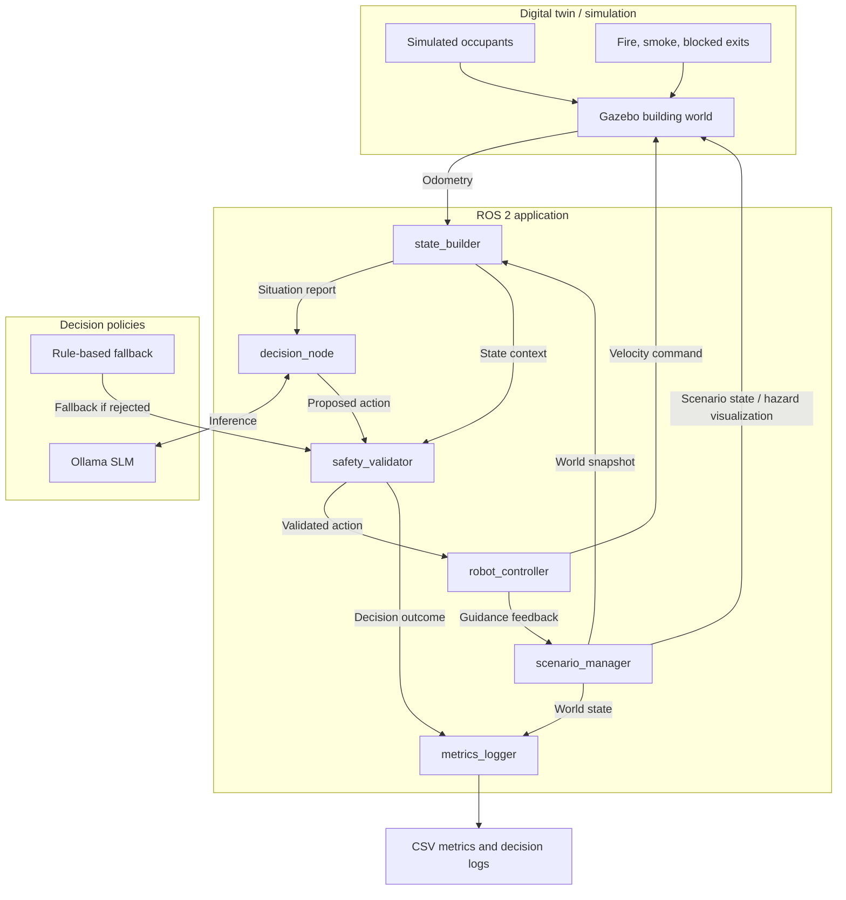
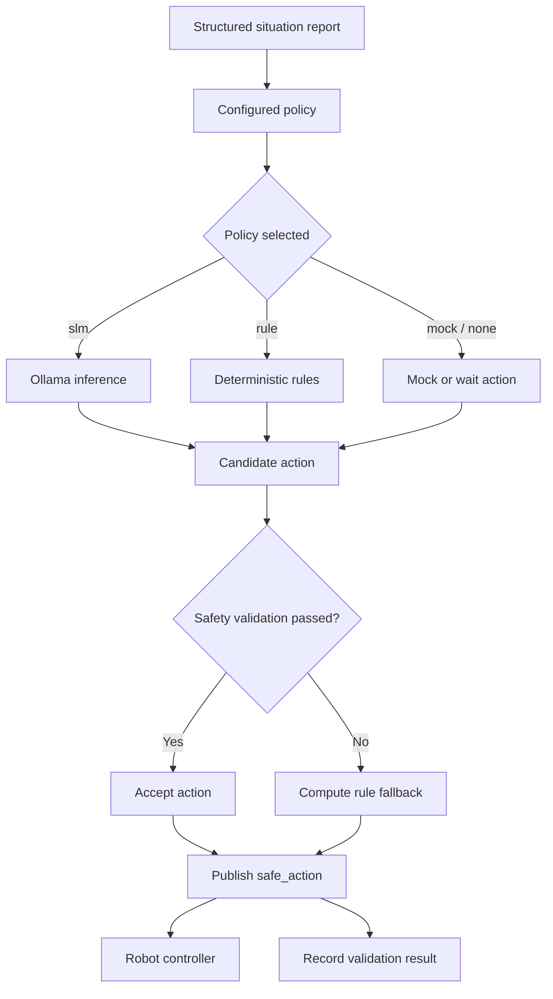
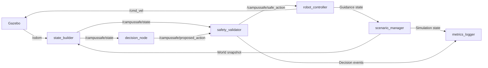
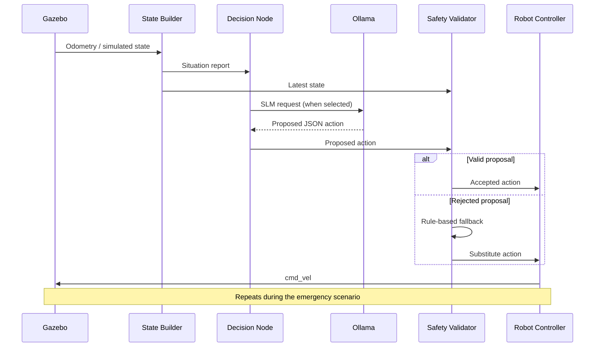
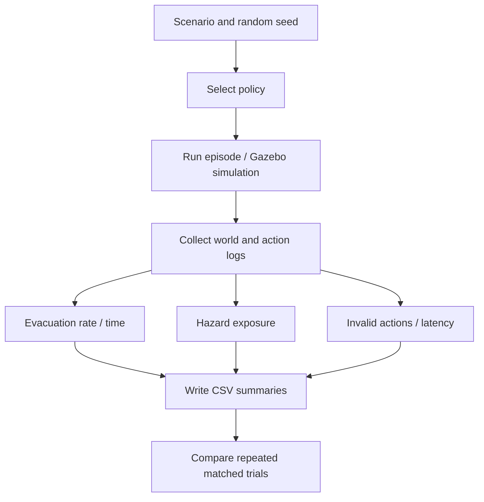

# CampusSafe Twin — System Design and Technical Architecture

**Project:** A Digital Twin and Small Language Model–Enabled Autonomous Humanoid Robotic Assistant for Campus Emergency Response and Resilience at Lamar University  
**Author:** Arnav Ghate  
**Date:** October 29, 2026  
**Status:** Simulation-based research prototype  
**Source:** [CampusSafe Twin repository](https://github.com/ARNAV-GHATE/campussafe-twin)

> Implementation status matters: the present code includes a ROS 2/Gazebo digital twin, simulated occupants/hazards, a simulated mobile robot, a local Ollama SLM policy, rule-based fallback, safety validation, and CSV metrics. It is **not** yet a physical humanoid robot or a live sensor-synchronized campus digital twin.

## 1. Abstract summary

CampusSafe Twin is a research framework for studying safety-constrained robotic assistance during campus emergencies. It simulates a building with rooms, corridors, exits, occupants, hazards, and an autonomous robot using Gazebo and ROS 2. A locally hosted Small Language Model (SLM) processes structured situation reports and proposes limited actions such as navigating to a location, guiding occupants to an exit, reporting hazards, announcing instructions, or waiting. A separate safety validator checks proposed actions against the known building graph and environmental state before they reach the robot controller, substituting a deterministic rule-based action if necessary.

The platform supports offline Python experiments and ROS 2/Gazebo simulation. It compares SLM, deterministic rule, mock-SLM, and no-robot policies using evacuation completion, evacuation time, hazard exposure, rejected action rate, decision latency, and guidance replanning time. The current system is a research simulator; its assumptions and results do not constitute real-world evacuation safety certification.

## 2. Glossary

| Term | Meaning |
|---|---|
| Digital twin | Simulation of a physical environment and its evolving state |
| SLM | Small Language Model; locally hosted inference for action selection |
| ROS 2 | Robotic software framework coordinating nodes and topics |
| Gazebo | Physics and robotics simulation environment |
| Ollama | Local model-serving runtime |
| SDF | Simulation Description Format used for the Gazebo world |
| Policy | Decision strategy converting a state into an action |
| Rule baseline | Deterministic policy for comparison and fallback |
| Safety validator | Checks candidate actions for permitted types and known safety constraints |
| Odometry | Robot position/motion estimate |
| Hazard | Simulated fire, smoke, or impassable blocked location |
| Replanning | Changing exit guidance after a route becomes unsafe |
| CSV | File format used for per-decision and per-experiment logs |

## 3. Problem statement

Campus evacuations are difficult when rooms are occupied, corridors fill with smoke, exits become blocked, and building-wide sensors fail. Static evacuation guidance cannot always account for dynamically changing hazards. While language models may support flexible decisions, they can also propose nonexistent destinations or unsafe actions. Directly executing model output would therefore create unacceptable risks.

**Research question:** Can a safety-validated SLM-assisted robot improve simulated campus emergency guidance and response compared with deterministic and no-robot baselines, while keeping latency and invalid actions measurable?

### Objectives

1. Construct a reproducible indoor emergency simulation with hazards and occupants.
2. Expose a structured environmental state to interchangeable decision policies.
3. Validate every proposed action before passing it to the robot controller.
4. Provide a deterministic fallback for rejected model proposals.
5. Benchmark evacuation outcomes, hazard exposure, latency, and action rejection.
6. Maintain a modular path toward richer maps, navigation, speech, and humanoid robotics.

### Scope

The current floor graph is a simplified modeled building, not a verified live campus floor plan. Events and occupants are simulated, and the robot uses a simplified mobile simulation model. Real campus sensors, production-grade navigation, physical humanoid actuation, and operational emergency deployment are out of scope.

## 4. Functional and non-functional requirements

### Functional requirements

| ID | Requirement | Status |
|---|---|---|
| FR-01 | Generate and load campus building simulation | Implemented |
| FR-02 | Simulate occupants, smoke, fire, and blocked locations | Implemented |
| FR-03 | Execute named emergency scenarios | Implemented |
| FR-04 | Build structured environmental situation reports | Implemented |
| FR-05 | Select actions through an Ollama-hosted SLM | Implemented |
| FR-06 | Support rule, mock, and no-robot baselines | Implemented |
| FR-07 | Check proposed actions against known safety constraints | Implemented |
| FR-08 | Replace rejected proposals with rule-based actions | Implemented |
| FR-09 | Send ROS 2 motion commands to a simulated robot | Implemented |
| FR-10 | Save outcome and decision metrics as CSV | Implemented |
| FR-11 | Operate a physical humanoid robot | Future work |
| FR-12 | Synchronize live campus sensor data | Future work |

### Non-functional requirements

| ID | Requirement | Evaluation method |
|---|---|---|
| NFR-01 | Safety constraint enforcement | Invalid-action/unit tests |
| NFR-02 | Resilience to model errors | Mock-policy and fallback tests |
| NFR-03 | Measurable decision latency | Mean and p95 latency logs |
| NFR-04 | Reproducibility | Fixed seeds, scenarios, repeated trials |
| NFR-05 | Modular components | ROS node and core-module separation |
| NFR-06 | Decision traceability | Proposed action, validity, reason, fallback logs |
| NFR-07 | Portable experimentation | Python offline runner |
| NFR-08 | Extensibility | Swappable models, policies, and robot interfaces |

## 5. Architecture

### 5.1 High-level system block diagram




The SLM does not send motor commands directly. The safety validator and controller form a deliberate boundary between model-generated decisions and robot actuation. Arrow labels simplify several internal ROS topic details; see the implementation files for exact transport.

### 5.2 Decision-validation workflow




**Supported actions:** `navigate_to`, `guide_to_exit`, `announce`, `report_hazard`, and `wait`.

The validator checks the action type, real building node identifiers, known hazard locations, safe/reachable exits, hazard-report references, and nonempty announcements up to 240 characters. It assesses **known** hazards and modeled routes, not unknown real-world risks.

### 5.3 ROS 2 data flow




The custom ROS 2 application contains six nodes: `scenario_manager`, `state_builder`, `decision_node`, `safety_validator`, `robot_controller`, and `metrics_logger`. A ROS–Gazebo bridge connects simulator odometry, velocity commands, and clock.

### 5.4 Sequence diagram




### 5.5 Emergency scenarios

| Scenario | Events |
|---|---|
| `fire_north` | Fire in N2 at 0 s; smoke at C15 at 45 s and C10 at 90 s |
| `blocked_exit` | EXIT_WEST blocked at 0 s; smoke at C38 at 60 s |
| `sensor_loss` | Fire at C30 at 0 s; sensor failure at 20 s; smoke at C25 at 50 s |
| `multi_hazard` | Fire at N3; EXIT_EAST blocked at 30 s; sensor loss at 60 s; smoke at C10 at 90 s |

The default occupant distribution totals 32 simulated people: N1 (4), N2 (6), N3 (5), N4 (3), S1 (4), LOBBY (6), and S3 (4).

### 5.6 Benchmarking pipeline




## 6. Q&A

**Why use a digital twin?** It permits reproducible, controlled emergency tests without endangering real people.

**Why compare SLM and rule-based policies?** The SLM may offer more flexible contextual reasoning, but it also introduces computational latency and invalid outputs. Comparisons establish whether benefits are measurable.

**Can hallucinations control motors?** No. Candidate actions are checked by an independent validator; rejected proposals are substituted with rule-based actions.

**What happens when an exit is blocked?** Known unsafe exits are marked in the state and rejected as guidance targets; the controller can instead receive guidance to an alternative safe exit.

**What happens during sensor loss?** Building-wide sensor knowledge becomes unavailable in the configured scenario. The simulation can evaluate the effects of partial observations.

**Does 0% rejected actions prove safety?** No. It only reports that the validator did not reject any actions in that trial. Unknown hazards and validation limitations still exist.

**Is the robot already a humanoid?** No. The current Gazebo prototype uses a simplified mobile robot. A humanoid model and physical platform are future extensions.

**What are the key thesis metrics?** Evacuation completion, total/mean evacuation time, people exposed, exposures, invalid action rate, average/p95 latency, and guidance replanning time.

**Can the model operate offline?** Local Ollama inference can work without a cloud inference service after installation and downloading the model.

**What would strengthen the results?** Repeat paired scenario/seed experiments, report distributions and uncertainty, isolate model failures, and test additional sensor-loss and evacuation cases.

## 7. Appendix

### A. Selected recorded results (October 28, 2026)

The repository includes multiple experiments under `results/gazebo/`. The following two **individual runs** are examples, not statistically aggregated results.

| Metric | Rule run `120531` | SLM run `131619` |
|---|---:|---:|
| Scenario | blocked_exit | blocked_exit |
| Occupants | 32 | 32 |
| Evacuated | 32 | 32 |
| Evacuated percentage | 100.0% | 100.0% |
| Total evacuation time | 123.0 s | 130.4 s |
| Mean evacuation time | 60.0 s | 83.2 s |
| People exposed | 7 | 8 |
| Decisions | 24 | 26 |
| Invalid actions | 0 | 0 |
| Mean decision latency | 0.0 ms (rounded) | 1594.5 ms |
| p95 decision latency | 0.1 ms | 2677.5 ms |

**Interpretation:** Both recorded runs evacuated all 32 occupants. The selected rule-based run had faster evacuation and fewer exposures; broader matched-seed experiments are required for general conclusions. Other saved SLM runs show different invalid-action rates, so it would be misleading to imply universal 0% invalid actions.

### B. Default configuration

| Parameter | Default |
|---|---|
| scenario | `fire_north` |
| policy | `slm` |
| model | `llama3.2:3b` |
| ollama_host | `http://localhost:11434` |
| rate_hz | 10.0 |
| decision_period | 5.0 s |
| seed | 0 |
| spawn_x, spawn_y, spawn_yaw | 20.0, 0.0, 0.0 |
| output_dir | `~/campussafe_results` if empty |

### C. Reproduction commands


```bash
# Python-only baseline
python run_offline.py --scenario blocked_exit --policy rule -v

# Offline comparison
python run_offline.py --policy slm rule none --model llama3.2:3b --trials 5

# Gazebo blocked-exit rule baseline (after building and sourcing ROS 2 workspace)
ros2 launch campussafe_twin campussafe.launch.py scenario:=blocked_exit policy:=rule

# Gazebo blocked-exit SLM run (with Ollama running)
ros2 launch campussafe_twin campussafe.launch.py scenario:=blocked_exit policy:=slm model:=llama3.2:3b

# Core tests
python3 -m pytest ros2_ws/src/campussafe_twin/test
```

### D. Source code map

- [README](../README.md) — project overview and setup
- [Simulation scenarios](../ros2_ws/src/campussafe_twin/campussafe_twin/core/scenarios.py) — hazards and event timing
- [Decision policies](../ros2_ws/src/campussafe_twin/campussafe_twin/core/policies.py) — rule, SLM, mock, and no-robot strategies
- [Safety validator](../ros2_ws/src/campussafe_twin/campussafe_twin/core/validator.py) — action acceptance checks
- [Launch file](../ros2_ws/src/campussafe_twin/launch/campussafe.launch.py) — Gazebo and ROS 2 node startup
- [Configuration](../ros2_ws/src/campussafe_twin/config/params.yaml) — default experiment parameters
- [Saved Gazebo results](../results/gazebo/) — per-run decision and summary CSVs

### E. Recommended next steps

Perform paired policy benchmarks with the same scenarios and seeds; aggregate outcomes across repeated trials; distinguish fallback-mediated success from accepted SLM decisions; replace the simplified map with a verified plan before discussing campus-specific deployment; investigate Nav2, speech, richer sensing, and humanoid embodiments as separately tested future extensions.
