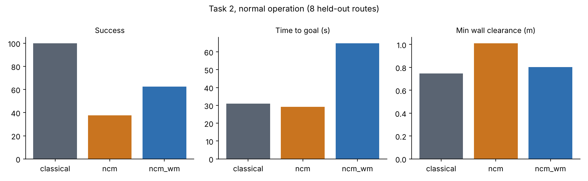
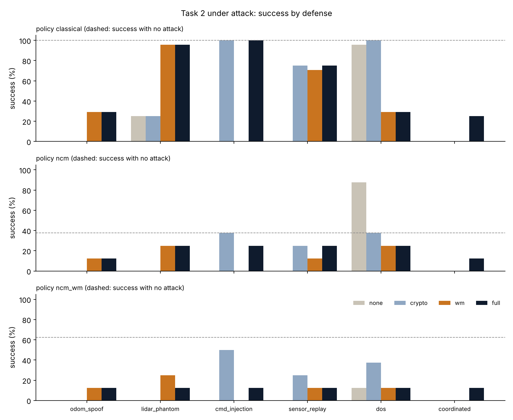

# Task 2 results: hazard-aware navigation under cyberattack

Generated by `run_nav_experiments.py` in 75.6 min: 1120 episodes, 8 held-out routes × 3 (classical) / 1 (learned) seed(s). Success = the robot's TRUE position ends within 0.75 m of the goal. Resilience R = (success under attack / normal) × min(1, time normal / time under attack), same defense.

## N1 – Normal operation (no attack, no defense)

| Policy | Success | Time (s) | Runs with a collision | Hazard exposure (s) | Min clearance (m) | Latency (ms) |
|---|---|---|---|---|---|---|
| classical | 100% | 30.9 | 0% | 0.0 | 0.75 | 0.03 |
| ncm | 38% | 29.1 | 0% | 0.0 | 1.01 | 2.70 |
| ncm_wm | 62% | 64.8 | 0% | 0.0 | 0.80 | 14.76 |

Per route, success / time (s):

| Route | classical | ncm | ncm_wm |
|---|---|---|---|
| corridor_west | 100% / 21.3 | 100% / 21.3 | 100% / 21.4 |
| room_to_main | 100% / 32.2 | 0% / – | 0% / – |
| lobby_to_n4 | 100% / 27.2 | 0% / – | 0% / – |
| long_haul | 100% / 42.2 | 0% / – | 100% / 95.6 |
| blocked_east | 100% / 32.2 | 0% / – | 0% / – |
| smoke_reroute | 100% / 27.9 | 0% / – | 100% / 61.2 |
| fire_behind | 100% / 22.0 | 100% / 21.9 | 100% / 101.4 |
| west_room | 100% / 42.2 | 100% / 44.1 | 100% / 44.6 |

## N2 – Attack impact without defense (success / runs with a collision)

| Attack | classical | ncm | ncm_wm |
|---|---|---|---|
| none | 100% / 0% | 38% / 0% | 62% / 0% |
| odom_spoof | 0% / 12% | 0% / 12% | 0% / 0% |
| lidar_phantom | 25% / 0% | 0% / 0% | 0% / 0% |
| cmd_injection | 0% / 100% | 0% / 100% | 0% / 100% |
| sensor_replay | 0% / 75% | 0% / 75% | 0% / 88% |
| dos | 96% / 38% | 88% / 50% | 12% / 12% |
| coordinated | 0% / 100% | 0% / 100% | 0% / 100% |

## N3 – Defenses, policy `classical`

Success / detection rate / resilience R.

| Attack | none | crypto | wm | full |
|---|---|---|---|---|
| none | 100% / FA 0% / R 1.00 | 100% / FA 0% / R 1.00 | 100% / FA 0% / R 1.00 | 100% / FA 0% / R 1.00 |
| odom_spoof | 0% / 0% / R 0.00 | 0% / 0% / R 0.00 | 29% / 100% / R 0.17 | 29% / 100% / R 0.17 |
| lidar_phantom | 25% / 0% / R 0.07 | 25% / 0% / R 0.07 | 96% / 100% / R 0.69 | 96% / 100% / R 0.69 |
| cmd_injection | 0% / 0% / R 0.00 | 100% / 100% / R 1.00 | 0% / 100% / R 0.00 | 100% / 100% / R 1.00 |
| sensor_replay | 0% / 0% / R 0.00 | 75% / 100% / R 0.47 | 71% / 100% / R 0.44 | 75% / 100% / R 0.47 |
| dos | 96% / 0% / R 0.42 | 100% / 100% / R 0.58 | 29% / 100% / R 0.21 | 29% / 100% / R 0.21 |
| coordinated | 0% / 0% / R 0.00 | 0% / 100% / R 0.00 | 0% / 100% / R 0.00 | 25% / 100% / R 0.19 |
| *runs with a collision* | 46% | 13% | 15% | 22% |

## N3 – Defenses, policy `ncm`

Success / detection rate / resilience R.

| Attack | none | crypto | wm | full |
|---|---|---|---|---|
| none | 38% / FA 0% / R 1.00 | 38% / FA 0% / R 1.00 | 25% / FA 75% / R 1.00 | 25% / FA 75% / R 1.00 |
| odom_spoof | 0% / 0% / R 0.00 | 0% / 0% / R 0.00 | 12% / 100% / R 0.30 | 12% / 100% / R 0.30 |
| lidar_phantom | 0% / 0% / R 0.00 | 0% / 0% / R 0.00 | 25% / 100% / R 0.99 | 25% / 100% / R 0.99 |
| cmd_injection | 0% / 0% / R 0.00 | 38% / 100% / R 1.00 | 0% / 100% / R 0.00 | 25% / 100% / R 1.00 |
| sensor_replay | 0% / 0% / R 0.00 | 25% / 100% / R 0.53 | 12% / 100% / R 0.30 | 25% / 100% / R 0.59 |
| dos | 88% / 0% / R 0.96 | 38% / 100% / R 0.59 | 25% / 100% / R 0.59 | 25% / 100% / R 0.59 |
| coordinated | 0% / 0% / R 0.00 | 0% / 100% / R 0.00 | 0% / 100% / R 0.00 | 12% / 100% / R 0.31 |
| *runs with a collision* | 48% | 9% | 4% | 4% |

## N3 – Defenses, policy `ncm_wm`

Success / detection rate / resilience R.

| Attack | none | crypto | wm | full |
|---|---|---|---|---|
| none | 62% / FA 0% / R 1.00 | 50% / FA 0% / R 1.00 | 12% / FA 88% / R 1.00 | 12% / FA 88% / R 1.00 |
| odom_spoof | 0% / 0% / R 0.00 | 0% / 0% / R 0.00 | 12% / 100% / R 0.60 | 12% / 100% / R 0.61 |
| lidar_phantom | 0% / 0% / R 0.00 | 0% / 0% / R 0.00 | 25% / 75% / R 1.80 | 12% / 88% / R 1.00 |
| cmd_injection | 0% / 0% / R 0.00 | 50% / 100% / R 0.90 | 0% / 88% / R 0.00 | 12% / 100% / R 1.00 |
| sensor_replay | 0% / 0% / R 0.00 | 25% / 100% / R 0.50 | 12% / 100% / R 0.58 | 12% / 100% / R 0.58 |
| dos | 12% / 0% / R 0.20 | 38% / 100% / R 0.44 | 12% / 100% / R 0.58 | 12% / 100% / R 0.58 |
| coordinated | 0% / 0% / R 0.00 | 0% / 100% / R 0.00 | 0% / 100% / R 0.00 | 12% / 100% / R 0.60 |
| *runs with a collision* | 43% | 12% | 2% | 2% |

## Figures

## Notes

- Attacks start 5 s into the run. A detection counts only alarms after that; any alarm in an attack-free run is a false alarm (FA).
- `wm` cannot reject forged commands (no key); it detects them and engages the motor interlock, so the robot stops safely but does not finish. `crypto` rejects them.
- The learned models were trained on random routes only; these routes are held out.
