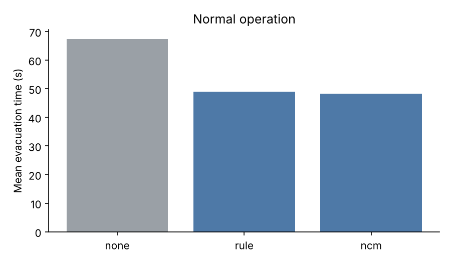
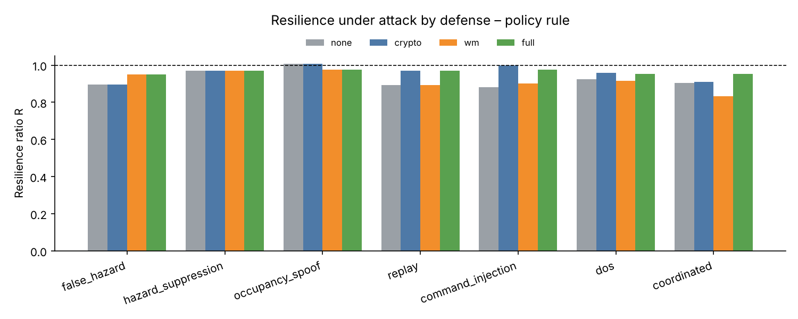
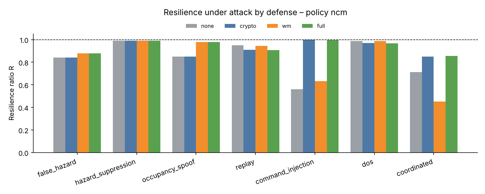

# Experiment results

Generated by `run_experiments.py` in 2.7 min: 1300 episodes, scenarios fire_north, blocked_exit, sensor_loss, multi_hazard, 5 seed(s) each.

## E1 – Normal operation

| Policy | Evacuated | Mean evac. time (s) | People exposed | Invalid actions | Decision latency (ms) |
|---|---|---|---|---|---|
| none | 97.5% | 67.3 | 5.9 | 0.0% | 0.0 |
| rule | 98.0% | 49.0 | 4.8 | 0.0% | 0.0 |
| ncm | 98.3% | 48.2 | 3.5 | 1.1% | 6.7 |

Per scenario (mean evacuation time, s):

| Policy | fire_north | blocked_exit | sensor_loss | multi_hazard |
|---|---|---|---|---|
| none | 56.4 | 81.8 | 65.3 | 65.7 |
| rule | 45.7 | 55.2 | 43.0 | 52.1 |
| ncm | 51.9 | 56.2 | 35.9 | 48.9 |

## E2 – Attack impact without defense

Resilience ratio R (1.00 = unaffected) and evacuation outcome.

| Attack | rule R | ncm R | rule evac / time / exposed | ncm evac / time / exposed |
|---|---|---|---|---|
| false_hazard | 0.89 | 0.84 | 87.7% / 43.5 s / 5.2 | 92.7% / 54.0 s / 5.5 |
| hazard_suppression | 0.97 | 0.99 | 96.7% / 49.8 s / 5.1 | 97.2% / 47.2 s / 3.9 |
| occupancy_spoof | 1.01 | 0.85 | 98.6% / 46.1 s / 3.6 | 98.9% / 57.2 s / 4.8 |
| replay | 0.89 | 0.95 | 97.8% / 54.9 s / 4.7 | 98.3% / 50.8 s / 3.5 |
| command_injection | 0.88 | 0.56 | 97.8% / 55.4 s / 4.8 | 86.7% / 75.8 s / 3.5 |
| dos | 0.92 | 0.99 | 98.0% / 53.0 s / 4.7 | 98.3% / 48.8 s / 3.6 |
| coordinated | 0.90 | 0.71 | 88.6% / 47.9 s / 4.8 | 72.2% / 49.7 s / 6.6 |

## E3 – Defenses, policy `rule`

Detection rate / mean detection delay (s) / resilience ratio R.

| Attack | none | crypto | wm | full |
|---|---|---|---|---|
| false_hazard | – / R 0.89 | 0% / – / R 0.89 | 100% / 0.0 / R 0.95 | 100% / 0.0 / R 0.95 |
| hazard_suppression | – / R 0.97 | 0% / – / R 0.97 | 55% / 55.2 / R 0.97 | 55% / 55.2 / R 0.97 |
| occupancy_spoof | – / R 1.01 | 0% / – / R 1.01 | 100% / 5.0 / R 0.98 | 100% / 5.0 / R 0.98 |
| replay | – / R 0.89 | 100% / 0.0 / R 0.97 | 0% / – / R 0.89 | 100% / 0.0 / R 0.97 |
| command_injection | – / R 0.88 | 100% / 0.0 / R 1.00 | 10% / 165.0 / R 0.90 | 100% / 0.0 / R 0.97 |
| dos | – / R 0.92 | 100% / 4.2 / R 0.96 | 0% / – / R 0.92 | 100% / 4.2 / R 0.95 |
| coordinated | – / R 0.90 | 100% / 0.0 / R 0.91 | 100% / 0.0 / R 0.83 | 100% / 0.0 / R 0.95 |
| *false alarms (no attack)* | 0% | 0% | 25% | 25% |
| *forged commands executed (command_injection)* | 15.9 | 0.0 | 22.1 | 0.0 |

## E3 – Defenses, policy `ncm`

Detection rate / mean detection delay (s) / resilience ratio R.

| Attack | none | crypto | wm | full |
|---|---|---|---|---|
| false_hazard | – / R 0.84 | 0% / – / R 0.84 | 100% / 0.0 / R 0.88 | 100% / 0.0 / R 0.88 |
| hazard_suppression | – / R 0.99 | 0% / – / R 0.99 | 5% / 221.0 / R 0.99 | 5% / 221.0 / R 0.99 |
| occupancy_spoof | – / R 0.85 | 0% / – / R 0.85 | 100% / 5.0 / R 0.98 | 100% / 5.0 / R 0.98 |
| replay | – / R 0.95 | 100% / 0.0 / R 0.91 | 25% / 80.0 / R 0.94 | 100% / 0.0 / R 0.91 |
| command_injection | – / R 0.56 | 100% / 0.0 / R 1.00 | 0% / – / R 0.63 | 100% / 0.0 / R 1.00 |
| dos | – / R 0.99 | 100% / 4.2 / R 0.97 | 0% / – / R 0.99 | 100% / 4.2 / R 0.97 |
| coordinated | – / R 0.71 | 100% / 0.0 / R 0.85 | 100% / 0.0 / R 0.45 | 100% / 0.0 / R 0.86 |
| *false alarms (no attack)* | 0% | 0% | 25% | 25% |
| *forged commands executed (command_injection)* | 26.4 | 0.0 | 19.1 | 0.0 |

## Figures

## Notes

- Attacks start 10 s after the alarm. `detected` counts only alarms raised after the attack started; any alarm in an attack-free run counts as a false alarm.
- Mean evacuation time covers evacuated people only, so read it together with the evacuated %.
- The learned components were trained on randomized scenarios only; the four named scenarios are held-out test cases.
